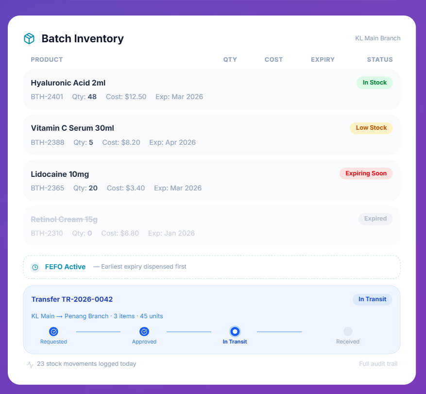

# MedicalMet: Inventory by Batch

**Type:** clinic management system (multi-branch clinics, Malaysia) with a batch inventory module
**Source:** https://www.medicalmet.advisoryapps.com/features/inventory-by-batch/
**Researched:** 9 Nov 2026, from the vendor's feature page (product UI shown as mock-ups on the page; not hands-on)

## Functionalities

- Batch recorded on receipt with batch number, cost price, quantity, expiry date, manufacture date and supplier invoice reference
- Batch list per branch with a status per row: In Stock, Low Stock, Expiring Soon, Expired
- FEFO applied automatically during billing and dispensing; the user never picks a batch
- Inter-branch transfer with numbered documents (format like `TR-2026-0042`) and four steps: Requested, Approved, In Transit, Received
- Quantity variance between shipped and received is flagged; a condition check (good, damaged, expired) on receipt
- Alerts for stock below a reorder level and for batches approaching expiry, lead time configurable per product
- Audit trail of every movement: who, when, quantity before and after

## What Polica takes

- **The transfer lifecycle.** Polica's transfer (#18, #19) uses the same four states: request, approval by the destination manager, shipping, receipt. The transfer card's "source -> destination, items, units" summary is a good layout for the transfer detail page.
- **Stock leaves the source at shipping.** "In Transit" stock is in neither branch's usable stock. This backs Polica's decision to decrement the source at SHIP and increment the destination at RECEIVE, so packs in transit cannot be FEFO-allocated.
- **FEFO without manual batch choice.** The pharmacist enters a medication and a quantity; the allocator picks batches (#15). The dispense result shows which batches were used.
- **Status chips in the stock list.** The stock overview (#14) shows a colored badge per row derived from days to expiry and the thresholds.
- **Document numbers with year.** Same pattern as Polica's `PO-{yyyy}-{00000}` from a SQL Server SEQUENCE; usable for transfers too.
- **Who, when, before/after.** StockMovement stores UserId, OccurredAt and a signed QuantityChange, which is enough to reconstruct before/after.

## What Polica leaves out, and why

- **Condition check and variance on receipt of a transfer.** Polica receives the full shipped quantity. Partial or damaged receipt would need a split into accepted and written-off quantities in one step, which doubles the transfer logic. A damaged pack can still be written off after receipt through #20.
- **Per-product alert lead time.** Polica uses two chain-wide thresholds in AppSettings. Per-medication thresholds would add columns and validation for a gain the chain administrator would rarely use.
- **Reorder alerts and automatic replenishment.** Polica shows low stock (below MinStockLevel) in a tab of the stock overview but sends no notifications; ordering stays a manager decision on a purchase order.
- **Billing, patient records, invoicing.** Polica is internal stock management; dispensing records quantities, not sales. Payments are out of scope by course rules.
