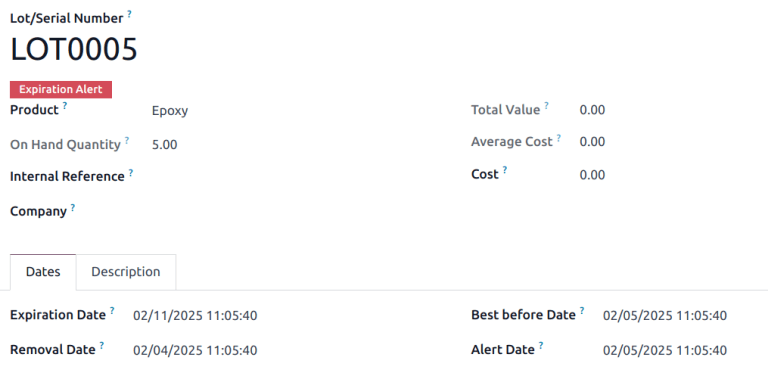
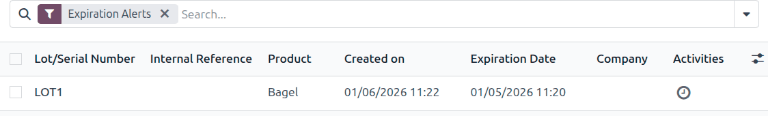
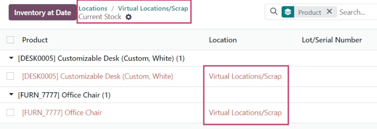

# Odoo Inventory

**Type:** general ERP inventory module with lot tracking, expiration dates and FEFO
**Sources:** https://www.odoo.com/documentation/master/applications/inventory_and_mrp/inventory/product_management/product_tracking/expiration_dates.html, https://www.odoo.com/documentation/17.0/applications/inventory_and_mrp/inventory/warehouses_storage/inventory_management/scrap_inventory.html
**Researched:** 9 Nov 2026, from the official documentation (not hands-on)

## Functionalities

- Products tracked by lot or by serial number; expiration data only on tracked products
- Four dates per product, in days: expiration time (from receipt), best before, removal, alert. Together they compute the dates on each lot
- A receipt cannot be validated until every line has a lot number; expiry is filled in the "Detailed Operations" pop-up
- Removal strategy (FIFO, LIFO, FEFO, closest location, least packages) set per location or per product category
- FEFO: if one lot does not cover the quantity, the remaining quantity comes from the lot with the next-soonest expiry
- Lots/Serial Numbers list: group by expiration date, "Expiration Alerts" filter, red banner on an expired lot's form
- Notification to the product's responsible user when a lot expires
- Scrap orders: product, quantity, source location, then Validate; stock moves to the virtual location "Scrap". Recent versions add a scrap reason field
- Traceability report per lot (every document the lot passed through)

## What Polica takes

- **Lot is required on receipt.** Goods receipt (#13) rejects a row without LotNumber and ExpiryDate, the same hard stop as Odoo's "cannot validate without a lot" error.
- **FEFO spill-over across batches.** The FEFO allocator (#15) takes the earliest-expiring batch first and continues with the next one when it runs out; one dispense line can produce several DispenseItems.
- **Alert date before expiry.** Odoo's "alert time" is the equivalent of Polica's first threshold.
- **Expiry as a list filter, not only a notification.** The stock overview (#14) gets an alert level filter and sorting by expiry, like Odoo's "Expiration Alerts" filter.
- **Traceability per batch.** StockMovement with one FK per source document gives the same "where did this batch go" answer as Odoo's traceability report.

## What Polica leaves out, and why

- **Four computed dates.** A medication's expiry is printed on the pack by the manufacturer and entered on receipt; it is never computed from a shelf life. Polica keeps one ExpiryDate per batch and global thresholds in AppSettings.
- **Configurable removal strategy.** Medication is always dispensed FEFO. A strategy choice per location would add configuration that no pharmacy should change.
- **Scrap without approval.** Odoo scraps on a single Validate click. Polica splits it into a pharmacist's proposal and a manager's approval (#20), because a write-off is a financial loss valued at cost and the manager is accountable for it.
- **Serial numbers.** Packs are counted, not serialized. Per-pack serialization (EU Falsified Medicines Directive) is a separate system.
- **Multi-step routes and virtual transit locations.** Polica models a transfer as one document with statuses instead of a warehouse routing engine; stock is off the shelf from Shipped to Received.
- **Sales, manufacturing, accounting.** Outside the topic.
