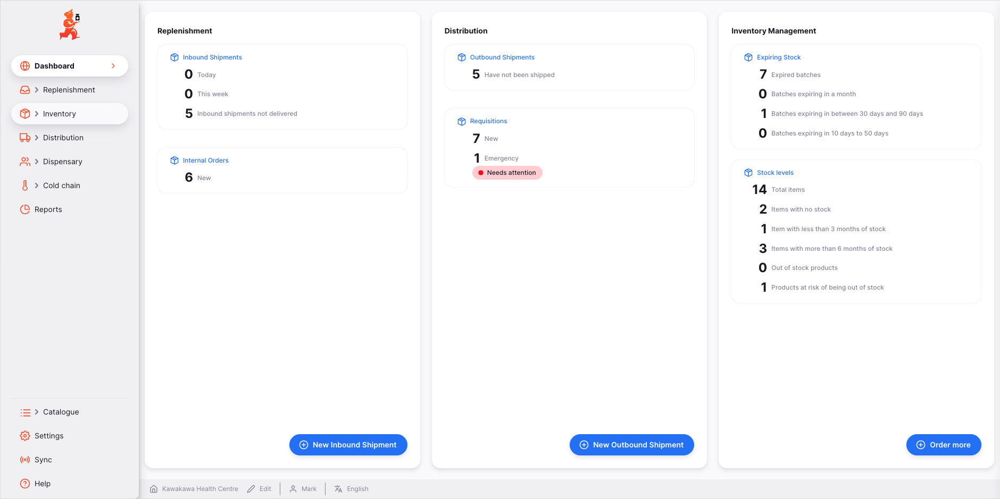
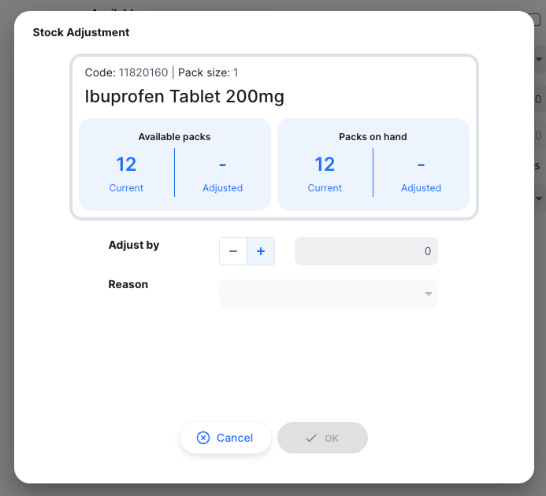

# Open mSupply

**Type:** pharmacy and medical supply inventory (open source, used by health ministries and dispensaries in 35+ countries)
**Sources:** https://docs.msupply.foundation/docs/getting-started/home/, https://docs.msupply.foundation/docs/inventory/inventory-adjustments/, https://docs.msupply.foundation/docs/inventory/stocktakes/
**Researched:** 9 Nov 2026, from the official documentation (not hands-on)

## Functionalities

- Stock tracked per stock line (item + batch + expiry + pack size + location) inside a store
- Landing dashboard with counts: expired batches, batches expiring within a month, batches expiring between a first and a second threshold, items with no stock, items with less than 3 months of stock (based on average monthly consumption)
- The two expiry thresholds are store preferences, not hardcoded
- Each dashboard count links to the list filtered by that condition
- Inventory adjustments (add/reduce stock) with a mandatory reason from an admin-defined list; the documentation says not to use them for receiving or distributing goods
- Stocktakes: counted vs snapshot quantity; a difference requires a reason and the stocktake generates the adjustments
- Movement between stores through outbound and inbound shipments, requested through internal orders/requisitions
- Ordering report that predicts expiry wastage from consumption rate and expiry date (mSupply v7.12+)

## What Polica takes

- **Two configurable thresholds.** Polica's First / Second / Expired alert levels with thresholds in AppSettings (#11, #16) follow the same idea: the pharmacy decides how early "near expiry" starts.
- **Dashboard counts that open a filtered list.** The chain and pharmacy dashboard (#21) tiles for near-expiry batches link to the stock overview (#14) with the alert level filter preset. Cheap to build, and it turns the dashboard into a starting point for work.
- **Mandatory reason on stock reduction.** WriteOffReason (#6) is required on every write-off, and `RequiresNote` forces a comment for reasons like "Damaged", matching mSupply's advice to always comment adjustments.
- **Write-off is not dispensing.** Same separation as mSupply: stock leaving through a write-off is a separate document type with its own StockMovement type.
- **Consumption as the signal.** mSupply uses average monthly consumption; Polica uses consumption over the last N days to rank transfer destinations (#17).

## What Polica leaves out, and why

- **Stocktakes.** A count-and-reconcile flow would add an entity and a second flow. Polica's stock only changes through documents (receipt, dispense, transfer, write-off), so quantities stay correct by construction within the scope of the project.
- **Requisitions / internal orders (pull model).** In Polica the pharmacy holding near-expiry stock starts the transfer (push). The problem Polica solves is moving stock away before it expires, not restocking a pharmacy that runs low.
- **Positive adjustments and backdating.** Adding stock without a receipt, or recording a change on an earlier date, would break the rule that every quantity change has a source document and a StockMovement in the same transaction.
- **Vaccine features (VVM status, open/closed vial wastage), repacking, offline sync between sites.** Not part of a retail pharmacy chain on one web app. Polica's unit is the whole pack.
- **Wastage prediction in ordering.** Interesting, but it belongs to purchasing optimization; Polica's purchase orders are entered by the manager.
